<h1 align="center">Hi, I'm Andrew Melad</h1>

<h3 align="center">
  Software Engineer | Full-Stack, Frontend & Mobile Development
</h3>

  

  

  

  

# About me

* Software Engineer working across frontend, backend and mobile applications
* Worked on ShipBlu, improving merchant and customer-facing web applications
* Built the first functional version of the ParcelPay Mobile App using React Native and TypeScript
* Built backend APIs, database schemas, integrations and tests for ParcelPay Backend
* Built Al Mtger, a merchant dashboard for products, orders, customers, payments and storefront management
* I enjoy building reusable component systems and improving existing application architecture
* I focus on fixing issues with APIs, authentication, permissions, performance and edge cases
* Interested in AI-powered products, automation and SaaS development
* Open to collaborating on web, mobile, backend and SaaS projects

### Ask me about

* React & Next.js
* Vue.js
* React Native & Expo
* JavaScript & TypeScript
* Frontend architecture & design systems
* Node.js & Express.js
* REST APIs
* PostgreSQL & TypeORM
* Authentication & authorization
* API validation with Zod & oRPC
* Jest & Supertest
* Responsive UI & RTL/LTR support
* AI integrations & automation workflows

### Currently exploring

* Next.js
* React Query
* Better Auth
* Neon Database
* Inngest
* AI automation
* n8n
* SaaS architecture

# Connect with me

  

  

# Languages and tools

<h3 align="center">Frontend development</h3>

  

<h3 align="center">Mobile development</h3>

  
  

<h3 align="center">Styling and UI</h3>

  

<h3 align="center">Backend development</h3>

  

  
  
  

<h3 align="center">Databases</h3>

  

<h3 align="center">Testing</h3>

  
  

<h3 align="center">Tools and systems</h3>

  

# Featured work

### ShipBlu

Worked on ShipBlu's merchant and customer-facing applications, improving reusable UI components, tables, filters, analytics, notifications and order workflows. Also fixed issues with responsive behavior, API data handling and frontend maintainability.

### Customer Portal

Migrated the Customer Portal to React, keeping the existing functionality and restructuring the application so AWS deployment and future maintenance are easier.

### ParcelPay Mobile App

Built the first functional version of the ParcelPay mobile app using React Native and TypeScript. It includes OTP authentication, onboarding, Arabic/English support, shipment tracking, profiles, saved addresses, Google Maps and REST API integration.

### ParcelPay Backend

Built backend APIs and database structures for shipments, addresses, tracking events, ratings and external integrations using Node.js, TypeORM, PostgreSQL, Zod and oRPC. Added authentication, API-key integrations and integration testing with Jest and Supertest.

### Al Mtger

Built a Vue 3 and TypeScript merchant dashboard for managing products, orders, customers, checkout links, payments, shipping and storefront customization. Worked on reusable validation, custom fields, image management, responsive previews, RTL/LTR support, permissions, token refresh and complex API edge cases.

### AI Personal Assistants

Built a full-stack app with 10 specialized AI assistants for different daily tasks, using Next.js, React, Node.js and external AI models.

# GitHub profile summary

  

  
  

  
  

# GitHub streak

  

# Contribution activity graph

  

# Complete GitHub overview

  

# Full-year contribution calendar

  

# Contribution snake

  <picture>
    <source
      media="(prefers-color-scheme: dark)"
      srcset="./assets/github-snake-dark.svg"
    />
    <source
      media="(prefers-color-scheme: light)"
      srcset="./assets/github-snake.svg"
    />
    
  </picture>

# Developer quote

  

# Contact

  Have an idea, project or collaboration opportunity?

  

  

 

  <i>
    GitHub Actions updates the statistics and profile assets every day.
  </i>

